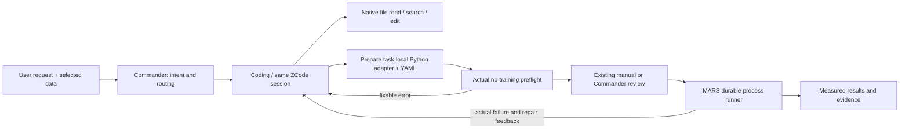

# Coding owns implementation and launch preparation

## Problem and resulting behavior

Commander previously had to read source before creating a Coding task. In the reported conversation it promoted a README/singleband example into a user requirement, despite the selected 80 MHz dual-carrier upload. An unavailable globally registered command also stopped preparation before Coding could fix it. ZCode ran in an empty private workspace with its own file tools disabled. Cleanup always required approval; hand-authored diffs were brittle.

The new division is:

- Coding creation no longer requires Commander source reads. Actual user messages, not the routing model's paraphrase, become the task input. Selected project data is included in routing context and the frozen selection overrides stale adapter data paths.
- An unavailable existing-model command falls back to Coding preparation. `code.prepare_execution` records a real Python adapter and YAML under `coding/prepared_commands.json`, scoped to this project/run. No global/manual registration is needed. The adapter consumes the existing request/result protocol and supports actual no-training validation. Training has a separate configurable timeout, rather than inheriting the 60-second utility command timeout.
- ZCode's **Read, Write, Edit, Glob, Grep** run against the isolated research checkout. MARS retains process supervision, job cancellation/recovery, data binding, approvals and result collection. Native Bash is not enabled. This is not a claim of an OS sandbox.
- Native edits have before/after snapshots and enter the same change ledger as MARS writes. The model need not repeat an already successful edit to make MARS recognize it. Scope/argument errors return actual tool feedback; they no longer masquerade as a fatal model-gateway failure.
- `code.delete_file` no longer has an unconditional human-approval requirement. Writable-checkout/path protections and recovery snapshots remain. This permission does not include arbitrary deletion of user data outside the checkout.
- Patch formatting normalizes newline endings, fences and hunk counts; Git handles short-context hunks. Local patch files are accepted inside the bound checkout. Real source matching, path containment and required execution YAML/data checks remain.

## Evidence

Real official ZCode + configured DeepSeek + CPU execution:

- Run: `2026-10-22T1735_zcode_coding_execution_acceptance`.
- Receipt: `runs/20261022T173512_coupled_validation/acceptance.json` (local, intentionally not committed).
- Native edits were observed twice; real pytest ran on the resulting code.
- First real job failed with `AttributeError: ... has no attribute 'sum_pair'`.
- MARS returned the actual failure to the **same** ZCode session (`sess_c0038f5b-12ea-40b3-b6d8-8597842d936d`); Coding repaired the compatibility entry.
- The next real CPU job completed, measured MSE **0.0**. Original failed-attempt history was retained. Both trace audits passed; source baseline was unchanged.
- This proves the coding/execution repair loop on arithmetic. It does **not** certify PIM training quality, data semantics or the full Idea/Experiment/Writing pipeline.

Regression coverage includes missing global registration, project/run isolation, selected-data precedence, actual adapter preflight/execution, cleanup recovery, malformed patch formatting, native write accounting and recoverable native path errors. The four new boundary/process regressions pass on Windows. Type checking passes for all 16 modified source modules. A separate actual-file check confirms prose-only plan edits remain admissible while changed seeds still block stale execution configuration.

## Boundaries and maintenance

Data fields that cannot be inferred reliably still require a concrete user question. Coding may repair loaders and launch code; it may not invent measurements or silently change the approved evaluation protocol. Legacy session checkpoints are not rewritten or falsely marked successful. Changed ZCode tool contracts use a new continuation fingerprint. Existing user model/configuration values must be preserved during deployment.
