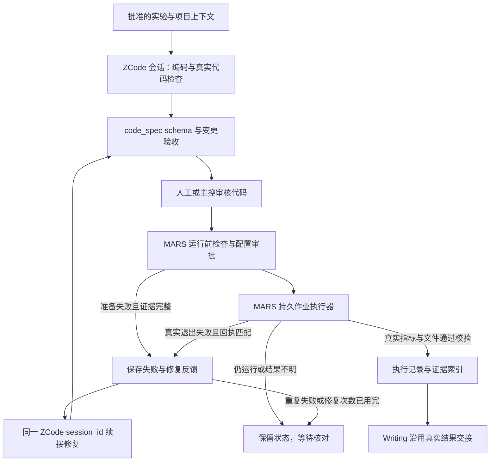

# ZCode 编码与执行闭环

实现日期：2026-10-22。基于上游 main 的 `8bf2891edf835f573b57e9ed9bf08c86aa5d2dd5`（2026-10-22 11:08 +08:00，PR #33）。开发分支 `codex/zcode-execution-20261022`。

## 范围

同一个 ZCode 会话负责实现代码、接收真实执行反馈、修复实现问题。前端继续显示编码和执行两个阶段；MARS 继续管理批准范围、实际进程、停止、恢复和证据。没有替换 LangChain/LangGraph，也没有把长时间训练交给不可恢复的模型 shell。

适用于普通 MARS 工作流的 ZCode 编码任务。原生编码后端、历史任务、封存的 research_task 合同图和 evolution/Auto Research 图继续走原有路径，本轮不把新的自动修复机制接入后两者。没有可验证的 ZCode 会话时不会假装接续上下文。

运行后自动修复目前核验 local_command 的真实退出回执；远端 GPU 等其他适配器继续保留原有失败处理，不把它们的状态当作已核验的本地退出证据。远端 GPU 和完整 PIM 工作负载不在本次验收范围内。

## 实际流程

ZCode 原进程可以在审核和训练期间退出，其会话数据库保留。新编码调用通过 `session/resume` 恢复原 `session_id`，不是启动一个失去历史的新会话。正式训练仍由既有 Execution 执行器运行；Execution Agent 本身在上游 main 就不调用模型。

## 状态、审批与材料

- `coding_execution/candidates/<node>.json` 绑定编码产物、通过验收的检查点、任务身份和研究输入哈希。
- `coding_execution/repairs/<node>.json` 保存真实失败原因、退出回执或运行准备证据、源检查点哈希和后续尝试编号。
- `coding_execution/results/<node>.json` 绑定完成后的实际指标与批次记录哈希。
- 原失败节点仍为 failed，新增 `coding_attempt_N → execution_attempt_N`。只有显式修复链最终成功，原失败才不再阻塞后续报告。
- 修复反馈写入与状态图持久化之间中断时，显式恢复会校验并补齐已登记的修复意图，不重放训练启动。
- 审批方式保持不变。代码修订和仿真配置重新走原有人工/主控审批。开发助手不会替真实研究任务审批。
- 会话续接校验任务、项目、模型、工具权限、运行时、原检查点哈希与轨迹完整性。研究计划、用户要求或数据选择变化时不自动沿用旧反馈。
- 结果不明、仍运行、缺少唯一失败回执、回执哈希不匹配时不自动修改代码或重新启动。重复失败停止自动修复。
- Writing 沿用实际 metrics、batch_summary 和经过回执校验的文件索引；没有把执行计划或模型自述当成结果。本轮没有重做报告材料压缩。

当前续接会发送最新任务上下文和失败反馈，复用 ZCode 已有会话历史；尚未实现跨调用的上下文增量去重。自动修复也不能消除真实的数据缺失、环境缺依赖或需要用户改变研究条件的问题。

## 配置

选择现有 ZCode 后端：`MARS_CODING_BACKEND=zcode`。`configs/coding_execution.yaml` 控制 enabled 和 max_repairs，默认启用、最多 3 次实现修复；这是防止重复失败的次数，不改变用户的模型输出或累计调用额度。设置 enabled: false 后不再新增修复尝试。

ZCode 使用现有 `configs/zcode.yaml`，也可用绝对路径环境变量 `MARS_ZCODE_CONFIG_PATH` 指定宿主配置。API key、模型和 token 设置沿用当前配置，不写入代码或此文档。

配套修复：命令发现与执行共用项目作用域检查；待创建的注册入口不再被提示为缺少用户资料。Windows 使用原生句柄读取代码并拦截重解析点/硬链接；代码快照保留真实 UTF-8 字节和换行；Git 调用局部启用长路径。ZCode 网关改成非流式调用时移除 stream_options，避免 DeepSeek 返回 400。

## 验证记录

真实验收脚本：`scripts/validate_coding_execution.py`。它创建隔离的算术项目，调用正式 ZCode CLI 和实际配置的模型、真实 Python 进程；自动批准只适用于脚本新建的合成测试项目。

2026-10-22 本地验证 `2026-10-22T1036_zcode_coding_execution_acceptance`：

- DeepSeek Flash 两次编码调用使用同一个 session_id，6 + 5 次实际模型请求。
- 首次真实运行因缺少 sum_pair 入口退出失败；错误交回原会话，补齐兼容入口后再次代码验收、审批和执行。
- 第二次执行完成，20 组整数计算的实测 MSE 为 0；实际结果文件、回执和指标一致。
- 原失败节点、原失败回执仍保留，原基线提交未改变。Writing 交接读取到实测指标和经过校验的文件索引。
- 使用该真实归档的副本验证了修复意图恢复与重复恢复幂等；未伪造模型结果，也未重放训练。
- 证据保存在本地 `runs/20261022T103600_coupled_validation/acceptance.json` 与该任务的 agent_traces、execution、coding_execution，模型会话、用户凭证和实验仓不纳入 Git。

这是首次编码—执行修复链路的真实 CPU 验收，不是完整 PIM 训练或报告质量验收。

### 本机部署与报告阶段补测

2026-10-22 按用户要求关闭上游草稿 PR #35，后续只同步用户 fork 的 `codex/zcode-execution-20261022` 分支。本机既有 `MARS-upstream-20261011` 安装目录切换到本分支，原提交、本地配置和改动另行备份，项目、数据、凭证与历史运行保留。现有 Python 环境增量同步依赖，复用原前端依赖；CPU 张量计算、后端导入和前端类型检查通过。前后端及项目列表代理接口均返回 200，ZCode 被运行服务识别为可用。

验收脚本新增 `--with-report`，继续调用真实 Writing 模型并校验批准报告的来源引用。第一次补测发现 Writing 的旧 JSON actions 协议收到模型同时生成的工具请求和自写 observation，五次格式修复后仍被拒绝；这些文本没有作为真实工具结果入账。Writing 默认改为已有的 `native_tools` 和原生观察历史，让工具调用及结果由宿主按协议关联，继续保留原有内容、来源和独立审查校验。脚本同时显式登记测试命令白名单，并要求出现真实成功的测试工具回执。

Windows 报告导出也发现两个路径格式问题：导出目录用 `str(Path(...))` 拼接后带反斜杠，被可移植相对路径校验拒绝；回执引用的曲线文件同样因平台分隔符被漏收。现在配置目录先按原有规则校验，再拼接可移植范围；实际证据文件转换为相对 POSIX 引用后继续核验范围和哈希，没有放宽路径边界。脚本增加真实逐步算术测量文件，并检查其 20 个记录进入导出包；不把这些记录称为模型训练曲线。两个原有 Windows 测试用例的换行比较和 Python 字符串路径转义也已修正。

最终验收 `2026-10-22T1200_zcode_coding_execution_acceptance` 全程通过：两次 Coding 使用同一 ZCode 会话（4 + 4 次真实模型请求），真实进程先失败、修复后 MSE=0，Writing 完成 10 次工具调用和一次审查，报告通过来源检查，Markdown/ZIP 及 20 条逐步测量均成功导出。证据为 `runs/20261022T120049_coupled_validation/acceptance.json` 与任务目录中的原始回执、轨迹和报告。保留最初失败节点；这是从 Coding 开始的 CPU 算术链路验收，Idea/Experiment 明确跳过，不代表 PIM 科学实验已验收。相关回归最终 70 项通过、4 项因指定历史实验归档未提供而跳过，3 个本轮修改的 Python 文件通过 mypy。

### 代码仓复制的时机

页面绑定项目外代码目录时，`bind_code_folder` 会先导入独立基线到项目 `code/<仓名>-<标识>`，创建 Git 初始提交，并记录来源和文件哈希。不会修改所选源目录；排除密钥、虚拟环境、缓存等文件。源仓中的 `data`、`datasets` 单独导入项目数据目录，可核验的数据路径及声明的检查点会相应本地化。选择项目内部已有目录时直接绑定，不重复导入。

开始编码任务时，再从项目基线创建该 run 的独立 Git 工作副本。原始源目录、项目基线和任务改动因此可以分开追溯；原始源目录后续变更不会自动同步到已有导入基线。复制范围由 `configs/project_storage.yaml` 定义，不是整个原目录的无条件复制。

相关回归覆盖项目命令作用域、审批与执行确认、结果交接、原生 Windows 文件边界、长路径、代码快照和回滚、官方 ZCode 握手及进程清理。Windows 测试的 LF 字节样本改为显式换行；POSIX 链接用例有真实 Windows junction 对应检查。失败用例修正后已逐项复测；18 个改动源码文件通过 mypy。完整跨平台 CI 和真实研究任务的服务重启测试仍需目标环境验证。

## 保留的后续建议

继续把运行规格、环境绑定和结果证据协议独立于 Agent 引擎。未来按实际收益评估 LangGraph 持久状态图、Idea/co-scientist 的候选评审，以及 evolve 的执行反馈；本轮不更换整个框架。原架构讨论材料仍在工作区 `outputs/mars-architecture-20261021/deliverables/MARS架构重构讨论稿_20261021_v1.pptx`。
